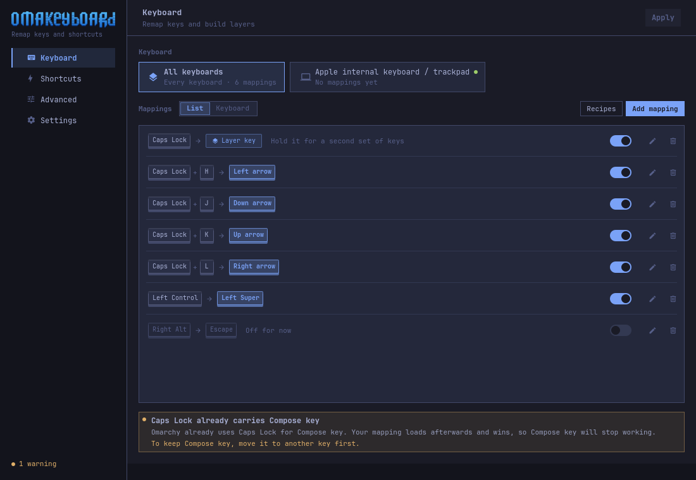
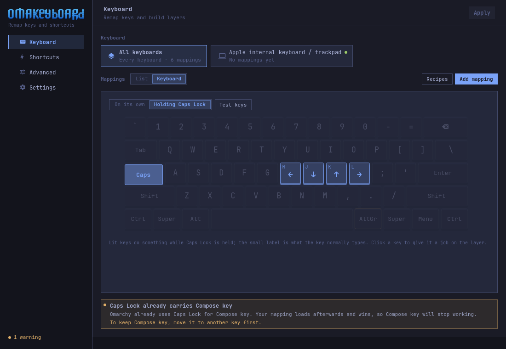
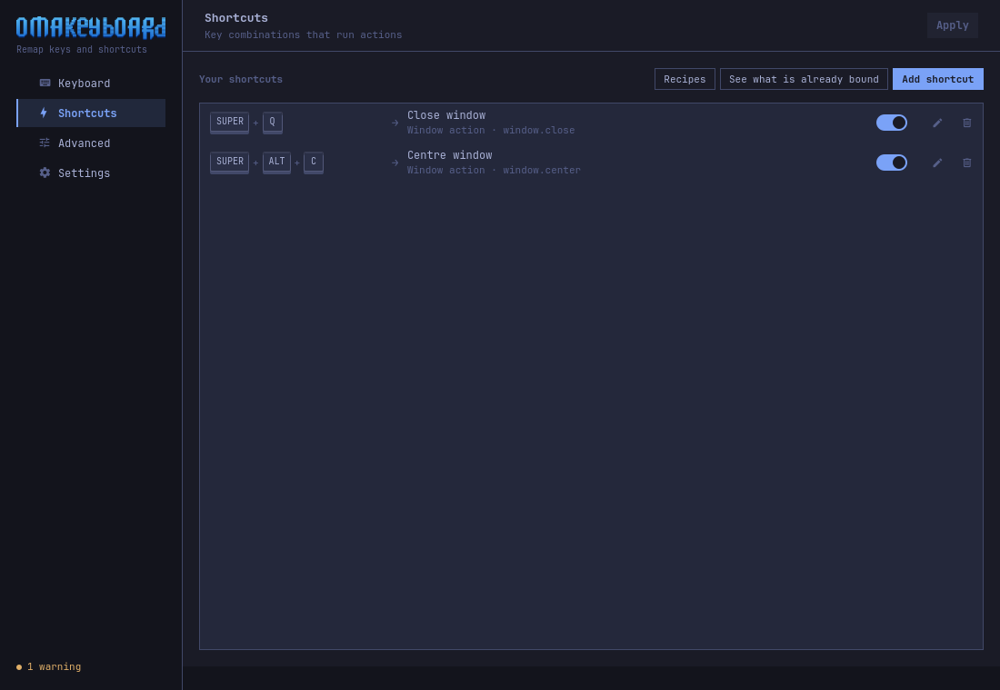
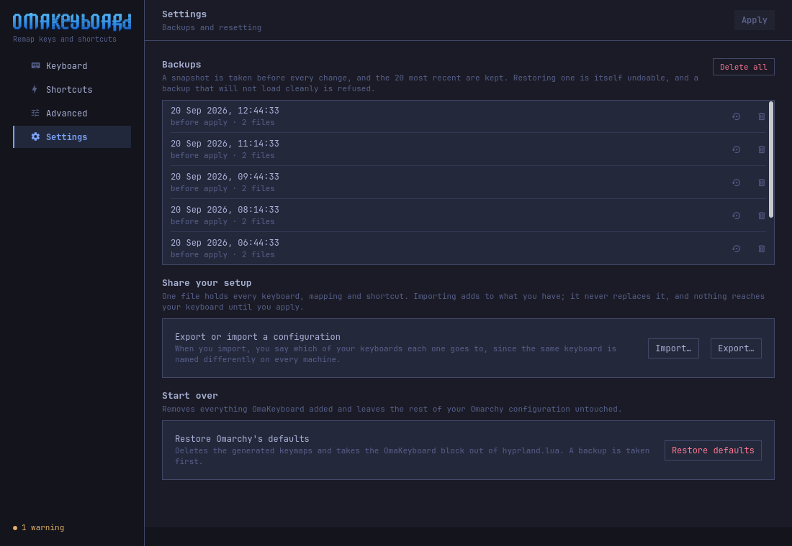

# OmaKeyboard

Keyboard remapping and shortcuts for [Omarchy](https://omarchy.org/), as a
normal desktop application. Conceptually a Karabiner-Elements for Omarchy:
you pick a key and say what it should do, per keyboard, and the app writes the
configuration.

Built with Qt 6 and Qt Quick, in the shape of
[Omawrite](https://github.com/omacom/omawrite) — its own process, its own
Wayland window, no Quickshell plugin and no bar widget.



## What it does

**Per keyboard.** Rules attach to a keyboard by the name Hyprland reports, so
the external keyboard and the laptop keyboard can behave differently. A rule
for a keyboard that is unplugged applies again the moment it comes back.

The keyboards you have are the keyboards you see — there is no "add a device"
step. Deciding which of them is really a keyboard is left to the system rather
than guessed from names: udev's `ID_INPUT_KEYBOARD` settles it, which keeps
power buttons and video buses out. One case needs more than that, because it
answers yes and types nothing: a Bluetooth radio publishes USB HID
boot-protocol endpoints so a paired keyboard works before the OS loads its
Bluetooth stack. Those are recognised by sitting on the same USB device as a
Bluetooth adapter, and dropped. A keyboard actually paired over Bluetooth
arrives through bluez as its own device and is offered normally.

**Remap any key.** Caps Lock to Control, Escape to nothing, Right Alt to
Compose. The app generates a real XKB keymap rather than picking from a fixed
list of layout options.

**Fn-style layers.** Turn a key into a layer chooser and the function row can
become brightness and volume while it is held, with the keys' normal meaning
intact. Two layers are available, one per XKB level, and a key can do
something different on each: H can be Left on one and Home on the other.

**The keyboard, drawn.** The list has a second view that shows your mappings
on the keys they belong to. Switching to a layer shows what the keys do while
its key is held, and clicking a key opens the editor for it. Only the block
every keyboard from 60% up shares is drawn: the physical size of a keyboard is
not something the system knows, and drawing keys you may not have is worse
than drawing fewer.



**Recipes.** Ready-made setups a click away — Caps Lock as Control, Caps Lock
as Escape, arrows under H J K L, Alt and Super swapped. Each one adds ordinary
mappings you can edit afterwards, and a recipe whose keys are taken says so
instead of doubling up. The shortcuts page has its own, each on a combination
nothing on your system is bound to yet.

**Shortcuts.** Key combinations that launch applications, run media and window
actions, or toggle system settings. Installed applications are read from their
`.desktop` files; Omarchy's own launchers and commands are discovered from the
installed version rather than hardcoded.



**A key tester on the drawing.** Press keys and watch them sink on the map,
with what each one types right now beside it. Holding a layer key shows that
layer for as long as it is held.

**Undo, and snapshots.** Deleting a mapping, a shortcut or a whole keyboard's
rules can be taken back for a few seconds, or with Ctrl+Z. Every apply takes a
snapshot first; the 20 most recent are kept, and any of them can be restored
or deleted from Settings.

**Share a setup.** Export writes every keyboard, mapping and shortcut as one
JSON file. Importing asks which of *your* keyboards each one goes to — device
names differ between machines — adds to what you have rather than replacing
it, and changes nothing until you apply.



**Conflict detection that knows your system.** It reads the bindings already in
effect — Omarchy's defaults and anything you wrote by hand — and tells you when
a mapping collides. On a stock install, "Caps Lock as Control" collides with
Omarchy's default `compose:caps`, and the app says so and what to do about it.

## What it cannot do

These are limits of XKB and Hyprland, not of the app, and it says the same
thing in the Advanced tab:

- **Tap for one thing, hold for another.** XKB has no notion of time.
- **Two keys at once producing a third.** XKB resolves one key at a time.
- **A key that types a sequence.** A key maps to a single symbol.
- **Different remaps per application.** The keymap belongs to the keyboard,
  not to the focused window.

Nothing is installed to work around these, and nothing is suggested.

## Driven from the keyboard

A keyboard app that needed a mouse would be an odd thing.

| Keys | |
|---|---|
| `Ctrl+1` … `Ctrl+4` | switch pages |
| `Ctrl+N` | new mapping, or new shortcut on the shortcuts page |
| `Ctrl+K` | list view or keyboard view |
| `Ctrl+L` | step through the layers in the keyboard view |
| `Ctrl+Tab` | next keyboard |
| `Ctrl+T` | the key tester, on the Advanced page |
| `Ctrl+Z` | undo the last deletion |
| `Ctrl+Return` | apply |
| `F5` | re-read everything from disk |

## Everything it uses is already on the system

| Piece | Used for |
|---|---|
| `libxkbcommon` | generating and validating keymaps; the same library Hyprland resolves them with |
| `hyprctl` | reading devices, applying changes, verifying the result |
| `lua` | reading the bindings that already exist |
| Qt 6 | the interface |

No input daemon, no background service, no third-party remapping engine.

## Install

From the repository:

```bash
git clone https://github.com/gabamnml/omakeyboard
cd omakeyboard
./bin/install      # builds, then makepkg -fsi
```

Or build without packaging:

```bash
./bin/build        # -> build/omakeyboard
./build/omakeyboard
```

Run the tests — no display and no Hyprland needed, every test runs against a
throwaway XDG root:

```bash
./bin/test        # the engine, plus the interface check below
./bin/smoke       # loads the QML, opens every page, fails on any warning
```

`bin/smoke` renders the app offscreen, so it needs neither a compositor nor a
display. The same mechanism takes the screenshots in this file:

```bash
QT_QPA_PLATFORM=offscreen OMAKEYBOARD_GRAB=shot.png OMAKEYBOARD_SIZE=1100x760 \
  ./build/omakeyboard
```

Requires `qt6-base`, `qt6-declarative`, `qt6-wayland`, `libxkbcommon`, `lua`
and `hyprland`, all of which an Omarchy install already has.

It also needs Omarchy 4 or newer, which is what configures Hyprland in Lua:
everything the app writes hangs off `~/.config/hypr/hyprland.lua`. On a
desktop without that file the app opens, says so, and refuses to write
anything.

## Files it writes

Four, and one marked block in a fifth:

```
~/.config/omakeyboard/rules.json        your rules; the app's source of truth
~/.config/omakeyboard/generated.lua     generated data table, no code
~/.config/hypr/omakeyboard.lua          the loader; fixed content, no user data
~/.local/state/omakeyboard/keymaps/     one generated .xkb per keyboard
~/.local/state/omakeyboard/backups/     a snapshot before every change

~/.config/hypr/hyprland.lua         one block, between these markers:
                                    -- >>> OmaKeyboard BEGIN …
                                    -- <<< OmaKeyboard END <<<
```

Nothing else in your configuration is touched. The block is appended after
Omarchy's own requires so its bindings win, it is idempotent, and
"Restore defaults" takes it back out.

### Why the split

The rules are JSON, which is parsed and never executed. The generated Lua is a
data-only `return { … }` table whose every string is escaped with Lua's own
quoting rules. The code that applies it is a separate, fixed file that contains
no user data at all and type-checks every field it reads; a damaged data file
degrades to "no mappings" instead of breaking your Hyprland configuration.

This follows a lesson Omarchy learned in the open — `default/hypr/toggles.lua`
carries a note about older generated Lua that "could carry an injected USB
device name" and "must never be loaded as code again".

## What happens when you press Apply

1. **Validate** every field against the system's own catalogues. A keysym is
   checked with `xkb_keysym_from_name`, because `xkbcli compile-keymap` accepts
   an unknown name and exits 0 — a successful compile is not proof.
2. **Detect conflicts**, against your rules, Omarchy's defaults, and the XKB
   option groups.
3. **Compile every keymap** with `xkbcli compile-keymap --test`.
4. **Back up** everything the apply may rewrite, as one snapshot.
5. **Write atomically** — a temporary file in the same directory, then
   `rename(2)`.
6. **Test-load** the whole Hyprland configuration in a sandboxed `lua` process
   with stubbed `hl` and `o`, so a broken file never reaches the compositor.
7. **Reload and verify** with `hyprctl reload`, `hyprctl configerrors` and a
   read-back of `input:kb_options`.

Any step failing restores the backup and reloads again. The dialog shows which
step it got to.

## About "press a key"

Capture reads what the compositor forwards, and nothing more. There is no
keyboard grab, because on Hyprland there is nothing to grab with — both routes
are dead ends, and both were checked rather than assumed:

- the **shortcuts-inhibit protocol** is how a client asks the compositor to
  stop resolving bindings. Hyprland implements it; Qt's Wayland backend does
  not (no `zwp_keyboard_shortcuts_inhibit` symbols in `libQt6WaylandClient`),
  so there is nothing to ask with.
- an **empty Hyprland submap** does suspend every binding. It also stops keys
  reaching the focused client at all (verified against 0.56.2: with a submap
  active, an injected keypress never arrives; with it reset, the same key
  does). So the window would see less, not more.

What this means in practice:

- **Capturing a remap's source key works.** A physical key is almost never
  bound on its own, which is the common case for a keyboard app.
- **Capturing a shortcut that is already taken does not.** Hyprland consumes
  it first. The app says so, and the key list and the "already bound" view are
  the way to pick those.

## Architecture

```
Qt Quick / QML  ── reads properties, calls invokables, writes nothing
      │
ConfigRepository ── the only door between interface and engine
      │
      ├── OmarchyConfigParser   rules.json + a sandboxed scan of the Lua config
      ├── ConflictDetector      your rules vs. the system
      ├── KeymapService         XKB keymap generation and compilation
      ├── OmarchyConfigWriter   data table, loader, managed block, atomic writes
      ├── ConfigBackupService   snapshots and rollback
      ├── HyprlandReloadService hyprctl: devices, reload, configerrors
      └── NativeEngine          what this system can and cannot do
```

QML never touches a file or a process. Everything below `ConfigRepository` is
plain C++ with no Qt Quick dependency, which is what lets the engine be tested
on its own.

## Releases

Two PKGBUILDs, because they build different things:

- `packaging/PKGBUILD` builds the working tree. This is what `./bin/install`
  uses, and what produces the package attached to a release.
- `packaging/aur/PKGBUILD` builds a tagged commit straight from the
  repository, and is what the AUR package contains. Its `omakeyboard.install`
  is a symlink to the one beside it, so publish that directory with
  `cp -rL packaging/aur <aur-checkout>`.

Cutting a release:

```bash
./bin/test                                  # engine and interface
git tag -a v0.1.0 -m "OmaKeyboard 0.1.0"
git push origin v0.1.0
cd packaging && makepkg -f
```

## Licence

MIT. See `LICENSE`.
