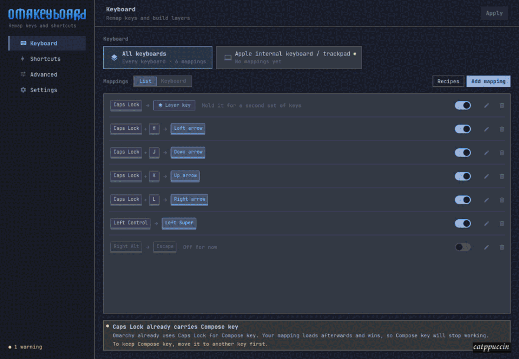
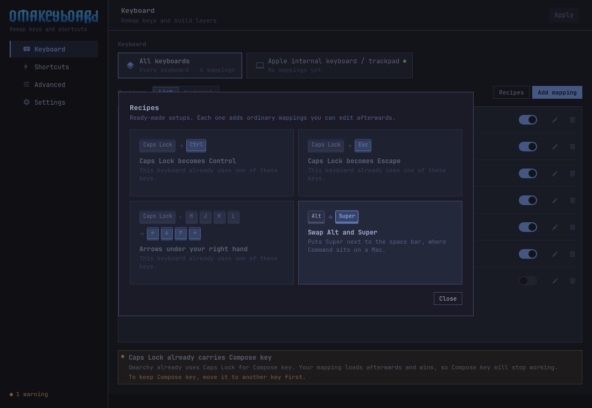
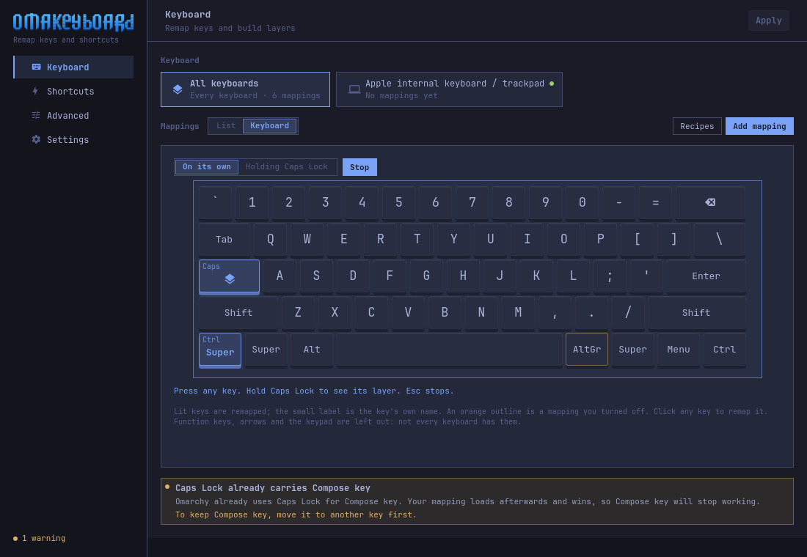
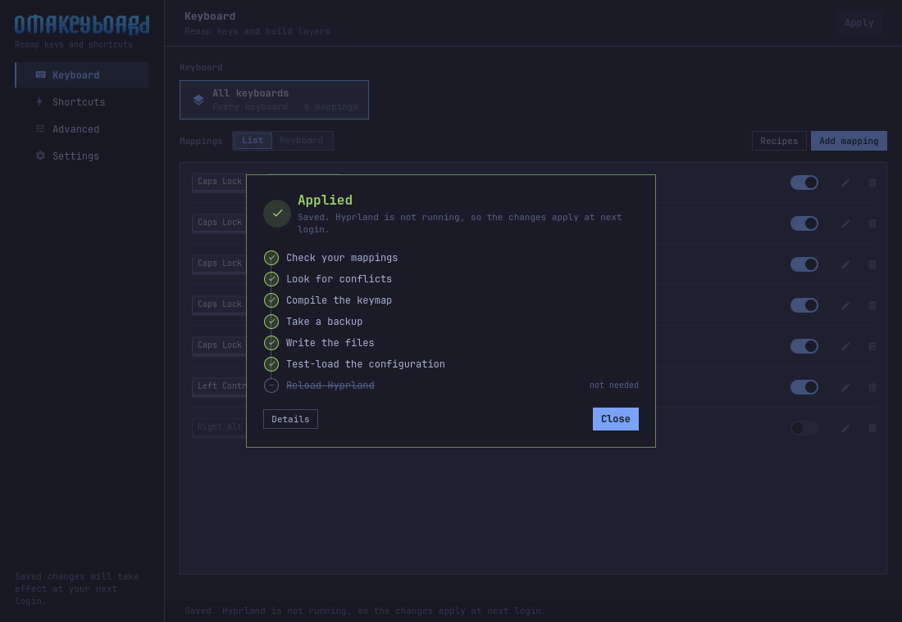

# OmaKeyboard

Make your keyboard type what you want. Caps Lock as Control, a layer that puts
arrows under your right hand, a shortcut for the app you actually use — per
keyboard, with no daemon running and no keymap to hand-edit.




Your mappings drawn on the keys they belong to. Switch to a layer to see what
it does while its key is held, and click a key to change it.


Start from a recipe instead of a blank page.



Press keys and see what they actually type, right now.



Shortcuts that launch apps, run window actions or toggle settings. It reads
what your system already uses, so it can say when two of them would collide.


Nothing reaches your keyboard until you apply, and an apply that goes wrong
puts everything back.



A snapshot before every change, and one file to hand your setup to someone
else.


## Install

OmaKeyboard is packaged in Omarchy's own repository:

```bash
omarchy-pkg-add omakeyboard
```

New packages land on Omarchy's edge channel first and reach stable with the
next Omarchy release. Until then, on stable, install the release package:

```bash
sudo pacman -U https://github.com/gabamnml/omakeyboard/releases/download/v0.1.0/omakeyboard-0.1.0-1-x86_64.pkg.tar.zst
```

Or build it:

```bash
git clone https://github.com/gabamnml/omakeyboard
cd omakeyboard
./bin/install
```

## Shortcuts

- `Ctrl+1` … `Ctrl+4` switch pages.
- `Ctrl+N` adds a mapping, or a shortcut on the Shortcuts page.
- `Ctrl+K` switches between the list and the keyboard.
- `Ctrl+L` steps through the layers in the keyboard view.
- `Ctrl+Tab` moves to the next keyboard.
- `Ctrl+T` starts the key tester.
- `Ctrl+Z` undoes the last deletion.
- `Ctrl+Return` applies.
- `F5` re-reads everything from disk.

## What it cannot do

Limits of XKB and Hyprland, not of the app, and it says the same in Advanced:

- Tap for one thing, hold for another. XKB has no notion of time.
- Two keys at once producing a third.
- A key that types a sequence.
- Different remaps per application.

Nothing is installed to work around these, and nothing is suggested.

## Where it writes

`~/.config/omakeyboard/` for your rules, `~/.local/state/omakeyboard/` for the
generated keymaps and the backups, and one marked block in
`~/.config/hypr/hyprland.lua`. Nothing else in your configuration is touched,
and "Restore defaults" takes all of it back out.

[How it works](docs/design.md) has the rest: the apply pipeline, why the
generated Lua contains no code, and what capturing a key can and cannot read.

## Requirements

- Omarchy 4 or newer, which is what configures Hyprland in Lua
- Qt 6: `qt6-base`, `qt6-declarative`, `qt6-wayland`
- `libxkbcommon`, `lua` and `hyprland`
- `xdg-desktop-portal` for the file picker and the desktop's dark mode

## Development

```bash
./bin/build          # -> build/omakeyboard
./bin/test           # the engine and the interface, no display needed
./bin/screenshots    # regenerates docs/screenshots, animation included
```

## Licence

MIT. See `LICENSE`.
